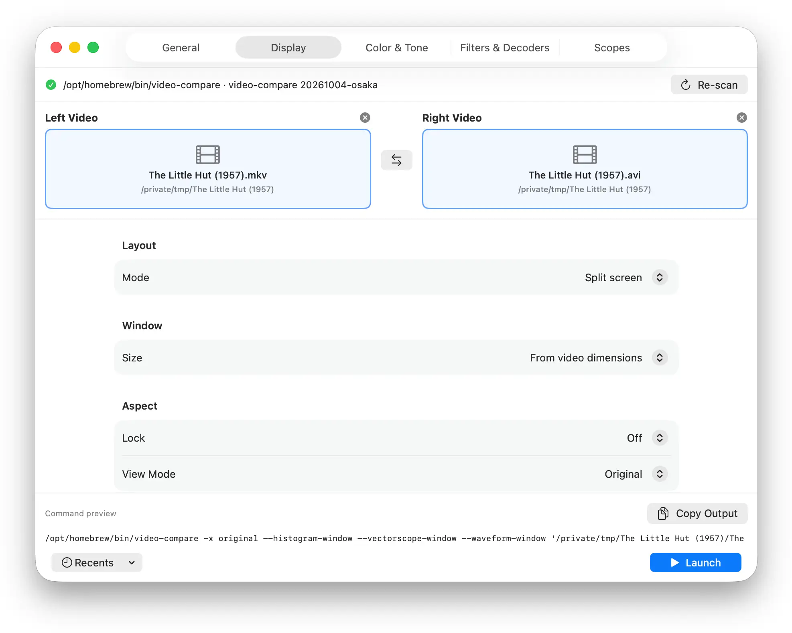

# Video-Compare GUI (macOS)

A native macOS GUI for pixop's [Video-Compare Tool](https://github.com/pixop/video-compare) written in Swift/SwiftUI 

## Screenshots



## Requirements

- [video-compare](https://formulae.brew.sh/formula/video-compare): `brew install video-compare`
- To build from source: macOS 14+ with Xcode 15+ (Swift 5.10+) — only the Command Line Tools are required, not the full Xcode IDE
- The compiled binary will run on macOS 13 (Ventura) or later

## Build & Run

```sh
git clone YOUR_REPOSITORY_URL.git VideoCompareGUI
cd VideoCompareGUI
./make_app.sh                     # builds "build/Video Compare.app"
open "build/Video Compare.app"    # or: ./make_app.sh --install  → /Applications
```


## Download

Precompiled binaries are available on the [Releases](https://github.com/suomi35/VideoCompareGUI/releases) page — download the latest `.dmg`, open it, and drag the app to `Applications`. No compilation required.

## First Launch (Gatekeeper)

The app is ad-hoc signed and is not notarized, so macOS may warn
"cannot be opened because it is from an unidentified developer" on first launch.
You have a couple of options to bypass:

##### Method 1: System Settings
1. Open the Apple menu () > **System Settings**
2. Navigate to **Privacy & Security**
3. Scroll down to the **Security** section, where you will see a message stating that the app was blocked from opening
4. Click **Open Anyway** and confirm using Touch ID or your administrator password

##### Method 2: via Terminal
&emsp;&emsp;&emsp;Run the following in Terminal:
   
   ```sh
   xattr -dr com.apple.quarantine "/Applications/Video Compare GUI.app"
   ```

The warning will not reappear after a successful first launch

## Features

- **Input wells** — click to choose, or drop video files onto the wells or the
  Dock icon; swap button and recent pairs included
- **Option tabs** covering every `video-compare` flag: General, Display,
  Color & Tone, Filters & Decoders, Scopes
- **Live command preview** — the exact command line is shown as you edit
- **Output capture** — errors and `stderr` from the last run surface in the app
- **Auto-discovery** — finds the `video-compare` binary (Homebrew, MacPorts, or
  `PATH`) and shows its version
- **Persistence** — options, last files and recents survive restarts
- **Localization** — all user-facing strings are externalized via `Localizable.strings`
  (English included); additional languages can be added by creating a new
  `.lproj` directory under `Sources/VideoCompareGUI/Resources/`

Shortcuts: `⇧⌘1` / `⇧⌘2` choose videos · `⇧⌘X` swap · `⇧⌘K` clear · `⌘↩` launch

## Development

```sh
swift build                                                  # debug build
./.build/debug/VideoCompareGUI --selftest                    # headless checks
./.build/debug/VideoCompareGUI --print-command-full          # sample full command
```

All views, models, and application core live in a single executable target
`VideoCompareGUI`

### Localization

Strings are defined in `Sources/VideoCompareGUI/Strings.swift` (typed
accessors) and their values live in
`Sources/VideoCompareGUI/Resources/en.lproj/Localizable.strings`. To add a
new language, create a sibling `.lproj` folder (e.g. `fi.lproj`) with a
translated `Localizable.strings` file and rebuild.

## Credits

- [pixop/video-compare](https://github.com/pixop/video-compare) — the CLI comparison tool itself
- Inspiration taken from [TetzkatLipHoka/VideoCompareGUI](https://github.com/TetzkatLipHoka/VideoCompareGUI) (Windows)

## License

This GUI is provided under the same terms as video-compare (GPLv2)  
See https://github.com/pixop/video-compare for the original tool and its license
